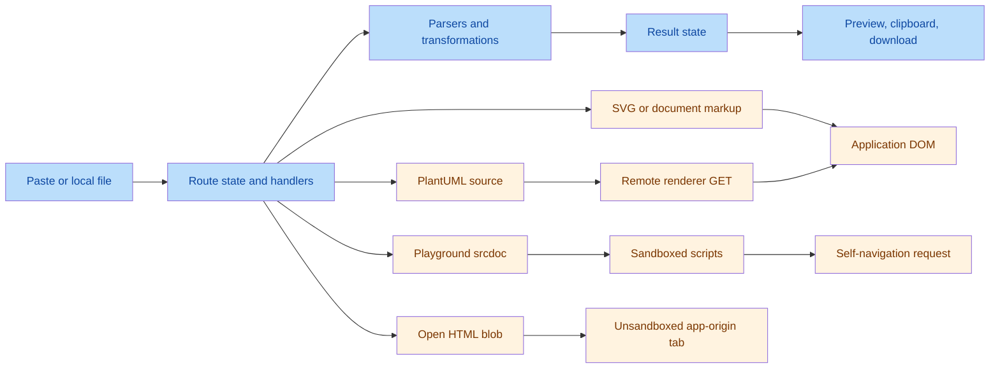
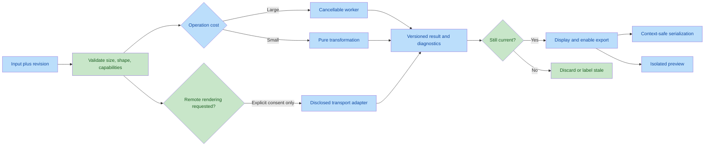

# Codebase Review

> **Historical document:** This review covers revision `6322e8d`. For the current working tree, see [`docs/audit.md`](./docs/audit.md) and [`docs/plan.md`](./docs/plan.md).

Date: 2026-09-25
Repository: jsonformatter / DataTools
Reviewed revision: `6322e8d`
Scope: current application source, shared components, conversion libraries, browser integrations, tests, and operational verification.

## Findings First

**31 findings: 0 confirmed critical application defects, 9 high, 19 medium, 3 low.** Both independent validators confirmed the existence of all 31 findings. Four initially proposed high severities were reduced to medium. Severity reflects application impact, not how difficult a fix is.

The highest priorities are unsafe active-content boundaries, discrepancies in privacy guarantees, silent conversion data loss, and unsafe generated shell commands. The application builds successfully, but its existing tests do not exercise these contracts.

The dependency audit separately reports a **critical-rated Next.js advisory entry**. That is not evidence that this deployment is exploitable; deployment and feature prerequisites remain unverified. See F23.

| No.        | Issue Title                                                            | Suggestion                                                                      | Code Link                                                                                                                           |
| ---------- | ---------------------------------------------------------------------- | ------------------------------------------------------------------------------- | ----------------------------------------------------------------------------------------------------------------------------------- |
| F01 High   | SVG preview executes imported active markup in the app origin          | Isolate rendering and enforce an SVG allowlist                                  | [SVG preview](file:///Users/kumarsatwik/Desktop/project/jsonformatter/src/app/svg-to-react/page.tsx#L291)                           |
| F02 High   | PlantUML transmits source despite local-only guarantees                | Disable remote rendering by default; require explicit consent or a local engine | [Remote transport](file:///Users/kumarsatwik/Desktop/project/jsonformatter/src/lib/plantuml.ts#L39-L45)                             |
| F03 High   | Playground Open removes sandbox isolation                              | Open a trusted sandbox host, not executable same-origin blobs                   | [Open handler](file:///Users/kumarsatwik/Desktop/project/jsonformatter/src/app/html-playground/page.tsx#L308-L312)                  |
| F04 High   | Playground CSP does not prevent navigation requests                    | Revisit the execution boundary and correct the no-network guarantee             | [Preview CSP](file:///Users/kumarsatwik/Desktop/project/jsonformatter/src/app/html-playground/page.tsx#L152-L162)                   |
| F05 High   | Hide-all leaks primitive values in mixed root arrays                   | Mask unkeyed leaves independently of object-key matching                        | [Root redaction](file:///Users/kumarsatwik/Desktop/project/jsonformatter/src/lib/sanitize.ts#L188-L190)                             |
| F07 High   | Native JSON round trips silently change numeric data                   | Preserve numeric tokens or reject unsupported values explicitly                 | [JSON parsing](file:///Users/kumarsatwik/Desktop/project/jsonformatter/src/lib/json.ts#L8-L11)                                      |
| F08 High   | CSV serialization silently drops later-only columns                    | Use explicit union fields and validate every row                                | [CSV generation](file:///Users/kumarsatwik/Desktop/project/jsonformatter/src/lib/csv.ts#L45-L55)                                    |
| F12 High   | Generated cURL commands are not safely shell-quoted                    | Quote every argument and validate HTTP methods                                  | [Shell escaping](file:///Users/kumarsatwik/Desktop/project/jsonformatter/src/lib/har.ts#L911-L936)                                  |
| F23 High   | Vulnerable dependencies remain on ingestion/rendering paths            | Triage reachability and update in tested batches                                | [Workbook ingestion](file:///Users/kumarsatwik/Desktop/project/jsonformatter/src/app/excel-to-csv/page.tsx#L32-L35)                 |
| F06 Medium | JSON-to-JS does not escape strings or keys                             | Serialize literals correctly and preserve special-key semantics                 | [Literal generation](file:///Users/kumarsatwik/Desktop/project/jsonformatter/src/app/json-to-js/page.tsx#L30-L54)                   |
| F09 Medium | Regex SVG conversion produces incorrect or invalid JSX                 | Parse XML and generate validated JSX structurally                               | [Attribute conversion](file:///Users/kumarsatwik/Desktop/project/jsonformatter/src/lib/svg-to-react.ts#L110-L135)                   |
| F10 Medium | forwardRef output ignores export selection                             | Emit the selected export after component declaration                            | [forwardRef branch](file:///Users/kumarsatwik/Desktop/project/jsonformatter/src/lib/svg-to-react.ts#L172-L210)                      |
| F11 Medium | Generated size and title props have incorrect semantics                | Preserve dimensions and put title inside SVG                                    | [Prop insertion](file:///Users/kumarsatwik/Desktop/project/jsonformatter/src/lib/svg-to-react.ts#L220-L237)                         |
| F13 Medium | HAR boundary validation is shallow; bad form escapes reject an archive | Validate nested fields and isolate per-entry errors                             | [HAR validation](file:///Users/kumarsatwik/Desktop/project/jsonformatter/src/lib/har.ts#L579-L592)                                  |
| F14 Medium | Large HAR files exceed argument limits and block the main thread       | Use iterative extrema, workers, and bounded body rendering                      | [Archive extrema](file:///Users/kumarsatwik/Desktop/project/jsonformatter/src/lib/har.ts#L653-L658)                                 |
| F15 Medium | HAR transfer totals mix decoded and transferred bytes                  | Model wire, encoded-body, and decoded sizes separately                          | [Size fallback](file:///Users/kumarsatwik/Desktop/project/jsonformatter/src/lib/har.ts#L438-L443)                                   |
| F16 Medium | HTTP 304 is reported as a redirect                                     | Classify redirect statuses explicitly                                           | [Status classification](file:///Users/kumarsatwik/Desktop/project/jsonformatter/src/lib/har.ts#L521-L527)                           |
| F17 Medium | CORS diagnostics omit origin and header mismatches                     | Compare origins and validate ACAO without overstating certainty                 | [CORS checks](file:///Users/kumarsatwik/Desktop/project/jsonformatter/src/lib/har.ts#L497-L509)                                     |
| F18 Medium | Third-party classification ignores public suffixes                     | Use registrable-domain parsing with an explicit private-suffix policy           | [Domain heuristic](file:///Users/kumarsatwik/Desktop/project/jsonformatter/src/lib/har.ts#L137-L141)                                |
| F19 Medium | Pending Markdown updates race exports and replacement documents        | Flush or cancel edits at document lifecycle boundaries                          | [Debounced synchronization](file:///Users/kumarsatwik/Desktop/project/jsonformatter/src/components/notes/markdown-pane.tsx#L32-L38) |
| F20 Medium | Opening a note leaves the source pane on the previous document         | Emit synchronization or replace a versioned document state                      | [File import](file:///Users/kumarsatwik/Desktop/project/jsonformatter/src/app/markdown-preview/page.tsx#L85-L90)                    |
| F21 Medium | Highlight preprocessing corrupts literal code                          | Implement highlights at the Markdown token level                                | [Global preprocessing](file:///Users/kumarsatwik/Desktop/project/jsonformatter/src/lib/notes/markdown.ts#L10-L12)                   |
| F22 Medium | Exported document titles are unescaped HTML                            | Escape text for each output context                                             | [Export document construction](file:///Users/kumarsatwik/Desktop/project/jsonformatter/src/lib/notes/exporters.ts#L113-L140)        |
| F24 Medium | Tests do not protect core application contracts                        | Add domain, browser, security, and resource-limit gates                         | [Existing test scope](file:///Users/kumarsatwik/Desktop/project/jsonformatter/tests/diagrams.test.ts#L1-L16)                        |
| F25 Medium | Shared Mermaid configuration has competing owners                      | Centralize renderer policy and lifecycle                                        | [Shared renderer](file:///Users/kumarsatwik/Desktop/project/jsonformatter/src/lib/diagrams.ts#L7-L19)                               |
| F28 Medium | Stale outputs and diagnostics can describe different inputs            | Version input/options/results and gate exports                                  | [Retained CSV output](file:///Users/kumarsatwik/Desktop/project/jsonformatter/src/app/csv-to-json/page.tsx#L50-L59)                 |
| F29 Medium | Spreadsheet upload does not enforce its advertised limit               | Validate before reading and limit expanded workbook work                        | [File acceptance](file:///Users/kumarsatwik/Desktop/project/jsonformatter/src/app/excel-to-csv/page.tsx#L70-L100)                   |
| F30 Medium | Upload and modal interactions lack keyboard guarantees                 | Use semantic file controls and focus-managed dialogs                            | [Drawer focus handling](file:///Users/kumarsatwik/Desktop/project/jsonformatter/src/components/har/request-drawer.tsx#L21-L24)      |
| F26 Low    | Duplicated helpers and obsolete modules increase drift                 | Consolidate verified duplication and remove unused feature code                 | [Duplicated pagination](file:///Users/kumarsatwik/Desktop/project/jsonformatter/src/components/har/domains-view.tsx#L10-L20)        |
| F27 Low    | Catalog promises features absent from current tools                    | Derive descriptions from tested capabilities                                    | [PDF export claim](file:///Users/kumarsatwik/Desktop/project/jsonformatter/src/lib/tools.ts#L116-L120)                              |
| F31 Low    | File and clipboard failures lack consistent feedback                   | Standardize local action errors and retry paths                                 | [File read lifecycle](file:///Users/kumarsatwik/Desktop/project/jsonformatter/src/components/editor-panel.tsx#L126-L133)            |

## Evidence and Limitations

- Inventoried 16 tool routes and 78 TypeScript/TSX source files, approximately 14,000 source lines.
- Read feature implementations and shared infrastructure; scanned the source tree for unsafe DOM sinks, network/storage APIs, incomplete code, imports, and repeated logic.
- An AST-based scan found 151 resolved local import edges and no cycles. This is a static-import scan, not a complete runtime dependency graph.
- `npm run check`: passed, with one unused `isHomepage` warning in `navigation.tsx`.
- `npm test`: four tests passed, all covering diagram helpers. No coverage percentage was measured.
- `npm run build`: passed; all 16 tool routes prerendered successfully.
- `npm audit --json`: 45 affected package entries: 1 critical, 8 high, 36 moderate. These are package-level results, including transitive effects, not 45 independent application exploits.
- Node reproductions confirmed numeric loss, CSV column loss, mixed-array redaction leakage, invalid generated literals, SVG output defects, HAR diagnostic errors, and a large-archive `RangeError`.
- Local production Chrome checks confirmed SVG script execution, playground self-navigation requests, same-origin privileges in the Open tab, and stale Markdown source after file import.
- Browser probes used synthetic data and localhost. No user payload was sent to PlantUML or another external rendering service; the remote path was established from source inspection. The storage probe checked accessibility without writing data.
- Existing untracked `.commandcode` work was left untouched. No application implementation was changed.
- This is a source-wide engineering review with targeted runtime checks, not exhaustive fuzzing, a complete accessibility certification, cross-browser acceptance testing, or a deployment penetration test. Chromium was the only browser tested.
- Earlier project memory described removed functionality. Current source, not historical memory, determined findings; intentionally removed features were not treated as implementation obligations.

## Detailed Findings

### Security and Privacy

#### F01 High: Active SVG is inserted into the application DOM

Evidence: [preview sink](file:///Users/kumarsatwik/Desktop/project/jsonformatter/src/app/svg-to-react/page.tsx#L291), [cleanup function](file:///Users/kumarsatwik/Desktop/project/jsonformatter/src/app/svg-to-react/page.tsx#L349-L354).

The function named `cleanSvgForPreview` removes declarations/comments, not scripts, event attributes, links, styles, or active HTML. A synthetic SVG containing `foreignObject` and an invalid data-image with `onerror` set a flag on the application window in Chrome. Imported markup can therefore execute in the tool's origin and manipulate/read the live page. React's escaping does not apply to this sink.

Implementation: render through an isolated, script-disabled preview boundary or an image context; validate a documented SVG element/attribute allowlist; restrict external resources. Do not treat XML declaration stripping as sanitization. Apply equivalent trust rules to remote diagram SVG before DOM insertion.

Acceptance: malicious attributes, `foreignObject`, external resources, and malformed XML cannot execute, access the parent, or initiate disallowed requests; ordinary SVG icons still render.

#### F02 High: PlantUML violates the advertised local-only contract

Evidence: [default endpoint](file:///Users/kumarsatwik/Desktop/project/jsonformatter/src/lib/plantuml.ts#L10-L11), [source-bearing GET](file:///Users/kumarsatwik/Desktop/project/jsonformatter/src/lib/plantuml.ts#L39-L45), [automatic note rendering](file:///Users/kumarsatwik/Desktop/project/jsonformatter/src/components/notes/diagram-block.tsx#L49-L63), [homepage guarantee](file:///Users/kumarsatwik/Desktop/project/jsonformatter/src/app/page.tsx#L24-L28).

Compression/encoding is reversible, not encryption. Diagram source is embedded in a URL to the configured renderer, defaulting to `www.plantuml.com`. Live rendering and imported note diagrams invoke this automatically. Source in a GET URL is also eligible for endpoint/proxy logs and HTTP caching. Whether the external service actually retains it was not inspected.

Implementation: disable external rendering under the current local-only contract. Either choose a browser-local renderer or make remote rendering an explicit, informed opt-in with a disclosed destination and accurate privacy wording. A self-hosted server still receives the source and is not browser-local. Invalidate pending requests and add cancellation/timeouts. Audit imported Markdown images and diagram resource URLs under the same policy.

Acceptance: a fresh session and imported note produce no source-bearing external request without consent. Offline/local-only paths remain usable and report unavailable engines honestly.

#### F03 High: Open runs playground code outside the sandbox

Evidence: [standalone Open](file:///Users/kumarsatwik/Desktop/project/jsonformatter/src/app/html-playground/page.tsx#L308-L312).

The generated blob is opened as a top-level document. It inherits the application origin but not the iframe's sandbox. Chrome reported the app origin and accessible origin storage APIs. `noopener,noreferrer` does not revoke these privileges. This does not demonstrate access to another tab's in-memory React state.

Implementation: open a trusted viewer shell that embeds the code in an isolated sandbox, or serve execution from a separate origin with no application privileges. Do not open executable user HTML as an app-origin blob.

Acceptance: Open preserves the preview's isolation guarantees; test origin access, storage access, opener access, navigation, and lifecycle cleanup.

#### F04 High: No-network CSP claim excludes a working egress path

Evidence: [CSP](file:///Users/kumarsatwik/Desktop/project/jsonformatter/src/app/html-playground/page.tsx#L152-L162), [promise](file:///Users/kumarsatwik/Desktop/project/jsonformatter/src/app/html-playground/page.tsx#L332), [sandbox permissions](file:///Users/kumarsatwik/Desktop/project/jsonformatter/src/app/html-playground/page.tsx#L540-L545).

`default-src` and `connect-src` do not prohibit a frame from navigating itself. Assigning the preview's location to a synthetic localhost URL caused an HTTP request during the browser check. Payload text can be carried in such a destination. The iframe still prevents normal parent DOM access; the defect is the network guarantee.

Implementation: remove unnecessary sandbox capabilities such as popups/forms, but do not present that alone as a fix. Define a realistic execution policy: an ordinary iframe CSP does not establish absolute network isolation for arbitrary JavaScript. Enforcing that guarantee requires an execution environment with controlled capabilities, or disabling execution under local-only mode. Until then, describe the actual restriction instead of claiming all network is blocked.

Acceptance: adversarial fetch, resource loading, self-navigation, popup, and form tests match the documented policy. Do not rely on an unsupported navigation CSP directive.

#### F05 High: Hide-all leaves unkeyed primitive siblings exposed

Evidence: [root forcing](file:///Users/kumarsatwik/Desktop/project/jsonformatter/src/lib/sanitize.ts#L188-L190), [array traversal](file:///Users/kumarsatwik/Desktop/project/jsonformatter/src/lib/sanitize.ts#L86-L101).

Input `["secret", {"name":"private"}]`, with hide-all enabled and `name` selected, produces `["secret", {"name":"[REDACTED]"}]`. Because an object key exists anywhere in the root array, primitive siblings receive no forced redaction and have no key to match.

Implementation: separate the policy for unkeyed array leaves from the selected-key exclusion policy. Preserve the documented ability to remove named keys from the list without exempting unrelated unkeyed leaves.

Acceptance: cover primitive roots, keyless arrays, mixed arrays, nested mixed arrays, empty containers, and deliberate named-key exclusions.

#### F12 High: cURL generation admits shell operators

Evidence: [method/URL handling](file:///Users/kumarsatwik/Desktop/project/jsonformatter/src/lib/har.ts#L905-L913), [escaping](file:///Users/kumarsatwik/Desktop/project/jsonformatter/src/lib/har.ts#L934-L936).

The generated command for `https://example.test/?a=1&b=2` is unquoted, so a shell treats `&` as a command separator/background operator. The HAR method is also interpolated without quoting or validation. Users executing copied commands can issue a different request or execute shell syntax embedded in untrusted fields.

Implementation: choose and label a supported shell dialect, quote all arguments unconditionally, validate HTTP method tokens, and pass URLs through `--url`. Separately verify body fidelity (`--data-binary` where needed) and disclose omitted cookie headers rather than suggesting exact replay.

Acceptance: inspect argv using a local stub, not live network calls. Test ampersands, quotes, dollar signs, backticks, newlines, empty arguments, and invalid methods.

#### F22 Medium: Export titles are executable markup

Evidence: [title interpolation](file:///Users/kumarsatwik/Desktop/project/jsonformatter/src/lib/notes/exporters.ts#L113-L125), [heading interpolation](file:///Users/kumarsatwik/Desktop/project/jsonformatter/src/lib/notes/exporters.ts#L131-L140).

Title text is inserted unescaped into HTML title and heading contexts. A title such as `A <B>` changes displayed content; crafted text can insert executable markup in the exported HTML when opened. Filename sanitization only protects the filename. This is an export trust-boundary problem, not evidence of current-page execution.

Implementation: reuse context-appropriate escaping or build text nodes before serialization. Keep user text separate from trusted document structure and sanitized rich content.

Acceptance: exported titles round-trip ampersands, angle brackets, quotes, and closing-tag sequences without new elements or script execution.

### Conversion Correctness

#### F06 Medium: JSON-to-JS emits invalid literals and special-key semantics

Evidence: [string emission](file:///Users/kumarsatwik/Desktop/project/jsonformatter/src/app/json-to-js/page.tsx#L23-L32), [key emission](file:///Users/kumarsatwik/Desktop/project/jsonformatter/src/app/json-to-js/page.tsx#L47-L54).

The converter interpolates decoded strings inside quotation marks without escaping. Embedded quotes/newlines break syntax; backslashes can change values. Emitting `__proto__` as an ordinary object-literal property also does not preserve a JSON own property.

Implementation: extract a pure serializer, use proper string-literal encoding, and emit special keys with semantics-preserving computed properties where needed. Make indentation consistent across arrays and objects.

Acceptance: compile and round-trip output containing quotes, backslashes, control characters, Unicode, special keys, and nested structures. The app does not execute generated output, so this is not classified as app-side code execution.

#### F07 High: JSON formatting and transformations lose numeric information

Evidence: [parse and serialize](file:///Users/kumarsatwik/Desktop/project/jsonformatter/src/lib/json.ts#L8-L31), [sorted comparison](file:///Users/kumarsatwik/Desktop/project/jsonformatter/src/app/json-compare/page.tsx#L127-L136).

`{"id":9007199254740993,"huge":1e400}` becomes `{"id":9007199254740992,"huge":null}` through the formatter. Sanitization and other parse/stringify workflows share the limitation. Sorted comparison can collapse distinct numeric values; default raw-text comparison does not.

Implementation: preserve lexical number tokens for formatting/comparison and adopt an explicit numeric representation policy for conversions. Where a target cannot represent a value, return an actionable warning/error rather than silently coercing it. Do not silently convert all numbers to strings either.

Acceptance: test unsafe integers, long decimal mantissas, large exponents, negative zero, and distinct inputs that currently normalize identically.

#### F08 High: CSV output and preview disagree on the schema

Evidence: [serializer](file:///Users/kumarsatwik/Desktop/project/jsonformatter/src/lib/csv.ts#L45-L55), [preview schema](file:///Users/kumarsatwik/Desktop/project/jsonformatter/src/app/json-to-csv/page.tsx#L75-L84).

`[{a:1},{a:2,b:3}]` produces only column `a`. Papa infers fields from the first record, while the table uses a union of all keys and therefore shows data missing from the download. Mixed primitive rows are not validated; some become blank records, while null records can throw.

Implementation: validate an array-of-records contract, derive ordered union fields once, and supply those fields to both serialization and preview. Define missing/null/nested-cell behavior. Also choose an explicit spreadsheet formula-safety mode: a string `=1+1` is currently exported as a formula-capable cell, and CSV quoting alone does not neutralize it.

Acceptance: round-trip disjoint keys, later-only keys, sparse records, null/primitive rows, nested cells, delimiters/newlines, and formula-like strings according to the chosen policy.

#### F09 Medium: Regex is not a reliable SVG-to-JSX compiler

Evidence: [regex conversion](file:///Users/kumarsatwik/Desktop/project/jsonformatter/src/lib/svg-to-react.ts#L110-L135), [weak input check](file:///Users/kumarsatwik/Desktop/project/jsonformatter/src/lib/svg-to-react.ts#L162-L167), [root rewriting](file:///Users/kumarsatwik/Desktop/project/jsonformatter/src/lib/svg-to-react.ts#L232-L237).

Verified defects include `gradientUnits` becoming `gradientunits`, `style="fill:red"` remaining a string instead of a React style object, literal text braces becoming JSX expressions, and valid `<svg/>` producing syntax errors after prop insertion. Component names are interpolated without identifier validation. A preview of the original SVG does not validate the generated component.

Implementation: parse XML, reject malformed/non-SVG roots, retain case-sensitive names, map attributes deliberately, convert style declarations structurally, and emit text as safe JSX literals. Use a maintained conversion pipeline where its output policy fits.

Acceptance: parse/typecheck generated JSX/TSX and render representative fixtures. Include gradients, filters, style declarations, text braces, quoted attributes, self-closing roots, namespaced attributes, `data-*`, and `aria-*`.

#### F10 Medium: forwardRef components are never exported

Evidence: [TS branch](file:///Users/kumarsatwik/Desktop/project/jsonformatter/src/lib/svg-to-react.ts#L172-L210), [JS branch](file:///Users/kumarsatwik/Desktop/project/jsonformatter/src/lib/svg-to-react.ts#L247-L281), [return](file:///Users/kumarsatwik/Desktop/project/jsonformatter/src/lib/svg-to-react.ts#L311).

Both forwardRef branches declare a local component and assign `displayName`, but never emit the requested default or named export.

Implementation: generate component declaration and export as separate, shared steps instead of duplicating export logic across branches.

Acceptance: import the generated module in every JS/TS, ref/no-ref, default/named, props/no-props combination.

#### F11 Medium: Generated optional props break dimensions and accessible titles

Evidence: [title and dimensions](file:///Users/kumarsatwik/Desktop/project/jsonformatter/src/lib/svg-to-react.ts#L220-L237).

`width={size}` and `height={size}` are appended even when dimensions already exist, producing duplicate attributes and overriding defaults with `undefined`. The generated `<title>` is a sibling of `<svg>`, not its SVG accessible title; in React 19 it can be treated as document-title metadata.

Implementation: define override precedence, retain original dimensions when no size is provided, and insert the title inside the SVG with an accessibility policy.

Acceptance: compile dimension-bearing fixtures, render with/without size, and inspect the SVG accessible name without changing the page title.

### HAR Reliability

#### F13 Medium: Invalid entry fields reject the entire archive

Evidence: [outer validation](file:///Users/kumarsatwik/Desktop/project/jsonformatter/src/lib/har.ts#L579-L592), [form decoding](file:///Users/kumarsatwik/Desktop/project/jsonformatter/src/lib/har.ts#L311-L318).

Validation only checks `log.entries`. Null entries and malformed nested types cause property-access errors. An otherwise usable entry with URL-encoded body `password=%` throws `URI malformed`, aborting the full analysis. The page catches the failure and displays an archive error; this is not an uncaught whole-app crash.

Implementation: validate required nested types at the boundary; normalize optional fields; retain entry-indexed diagnostics. Use tolerant form parsing or catch invalid encodings locally. Do not discard valid entries because one heuristic fails.

Acceptance: malformed entries, optional fields, invalid escapes, nonstring headers, and wrong numeric types produce precise diagnostics without corrupting neighboring entries.

#### F14 Medium: Large archives exceed runtime limits

Evidence: [100MB acceptance](file:///Users/kumarsatwik/Desktop/project/jsonformatter/src/components/har/empty-state.tsx#L46-L51), [synchronous call](file:///Users/kumarsatwik/Desktop/project/jsonformatter/src/app/har-analyzer/page.tsx#L347-L349), [spread extrema](file:///Users/kumarsatwik/Desktop/project/jsonformatter/src/lib/har.ts#L653-L658), [timeline extrema](file:///Users/kumarsatwik/Desktop/project/jsonformatter/src/components/har/timeline.tsx#L30-L37), [body modes](file:///Users/kumarsatwik/Desktop/project/jsonformatter/src/components/har/body-viewer.tsx#L140-L146).

A synthetic 150,000-entry archive failed with `RangeError: Maximum call stack size exceeded` from spread arguments. The fixture is below the advertised file-size ceiling. The measured Node run reached failure in approximately 437ms; this is a reproduction, not a browser performance benchmark. Analysis, search-corpus construction, full body decoding, and JSON pretty-printing run synchronously on the UI thread. Raw/tree body modes bypass the pretty-view truncation.

Implementation: replace spreads with iterative aggregation; perform parsing/analysis/search in workers with cancellation; decode and format lazily under explicit budgets. Pagination already exists for requests and a row cap exists for timelines; retain them and bound expensive preprocessing as well.

Acceptance: benchmark realistic 1MB, 10MB, and 100MB fixtures; test entry-count extremes and a single oversized body. Establish measured responsiveness/memory budgets and graceful rejection, not unsupported “instant” guarantees.

#### F15 Medium: Transfer totals are not wire-byte totals

Evidence: [fallback order](file:///Users/kumarsatwik/Desktop/project/jsonformatter/src/lib/har.ts#L438-L443), [transfer label](file:///Users/kumarsatwik/Desktop/project/jsonformatter/src/components/har/overview.tsx#L198).

An explicit `_transferSize: 0` is ignored. Decoded `content.size` is preferred over `bodySize`, so cached or compressed responses inflate metrics labelled “Data transferred.”

Implementation: model transfer, encoded body, and decoded body separately. Preserve zero and unknown values; make fallback provenance visible.

Acceptance: cached zero-byte responses, compressed content, missing values, and HAR unknown-size sentinels do not masquerade as measured network traffic.

#### F16 Medium: Cache revalidation is counted as a redirect

Evidence: [3xx branch](file:///Users/kumarsatwik/Desktop/project/jsonformatter/src/lib/har.ts#L521-L527), [request badge](file:///Users/kumarsatwik/Desktop/project/jsonformatter/src/components/har/request-explorer.tsx#L114-L116).

HTTP 304 is labelled “304 Redirect” and counted in redirect metrics, despite the status explanation elsewhere correctly describing cached content.

Implementation: centralize HTTP status classification and use actual redirect statuses consistently across analysis, badges, filters, and explanations.

Acceptance: 301/302/303/307/308 redirect; 304 is cache validation, not a redirect.

#### F17 Medium: CORS checks compare hosts, not origins

Evidence: [CORS checks](file:///Users/kumarsatwik/Desktop/project/jsonformatter/src/lib/har.ts#L497-L509).

`http://a.co.uk` and `https://a.co.uk` are different origins but compare equal by host. A nonempty ACAO belonging to the wrong origin is also treated as sufficient. These are diagnostic omissions; a HAR alone does not establish all browser CORS outcomes.

Implementation: compare `URL.origin`, evaluate ACAO against the request origin, and distinguish definite mismatches from incomplete capture evidence. Treat credential/preflight cases separately.

Acceptance: scheme, port, matching/mismatching ACAO, wildcard, opaque/null origin, and incomplete preflight fixtures have documented outcomes.

#### F18 Medium: Domain ownership classification ignores suffix boundaries

Evidence: [domain heuristic](file:///Users/kumarsatwik/Desktop/project/jsonformatter/src/lib/har.ts#L137-L141), [consumer](file:///Users/kumarsatwik/Desktop/project/jsonformatter/src/lib/har.ts#L447-L450).

Unrelated `a.co.uk` and `b.co.uk` requests are classified as the same party. Private hosting suffixes have similar problems. The implementation documents a heuristic, but the UI presents a first/third-party result without that limitation.

Implementation: use a maintained public-suffix-aware parser, document private-suffix treatment, and retain explicit IP/localhost behavior.

Acceptance: multi-label country suffixes, private hosting domains, subdomains, IP addresses, and localhost classify consistently.

### Document and UI State

#### F19 Medium: Debounced Markdown edits outlive their document

Evidence: [timer](file:///Users/kumarsatwik/Desktop/project/jsonformatter/src/components/notes/markdown-pane.tsx#L32-L38), [blur](file:///Users/kumarsatwik/Desktop/project/jsonformatter/src/components/notes/markdown-pane.tsx#L48-L51), [export snapshot](file:///Users/kumarsatwik/Desktop/project/jsonformatter/src/app/markdown-preview/page.tsx#L93-L96).

The 500ms source-to-editor update is neither flushed at export/blur nor cancelled on pane unmount or document replacement. Immediate export can read old content, and a surviving timer can overwrite a newly opened document.

Implementation: centralize document revision and pending-edit ownership. Flush before export or intentional view changes; cancel obsolete revisions on replacement/unmount. Do not reset the textarea from stale editor content on blur.

Acceptance: fake-timer and browser tests cover typing followed immediately by export, source-pane toggle, file open, rich-text editing, and navigation.

#### F20 Medium: File import does not synchronize the mounted source pane

Evidence: [suppressed update](file:///Users/kumarsatwik/Desktop/project/jsonformatter/src/app/markdown-preview/page.tsx#L85-L90), [only update subscription](file:///Users/kumarsatwik/Desktop/project/jsonformatter/src/components/notes/markdown-pane.tsx#L20-L28).

Opening another file while the Markdown pane is visible replaces the rich editor but leaves the source pane on the previous file. Chrome reproduced this with a local non-sensitive Markdown file.

Implementation: emit the event the pane observes, or explicitly distribute a new document revision to both views. Coordinate with F19 so stale callbacks cannot restore the previous file.

Acceptance: opening a file refreshes both views immediately, with and without a focused source pane.

#### F21 Medium: Markdown preprocessing modifies code examples

Evidence: [highlight preprocessor](file:///Users/kumarsatwik/Desktop/project/jsonformatter/src/lib/notes/markdown.ts#L10-L12), [parse ordering](file:///Users/kumarsatwik/Desktop/project/jsonformatter/src/lib/notes/markdown.ts#L26-L30).

Inside either a code fence or inline code, `a == b == c` becomes `a <mark> b </mark> c` as literal escaped code. Global replacement runs before the parser can identify code regions.

Implementation: implement highlight as an inline token extension that excludes code and escaped delimiters.

Acceptance: prose highlights work; code fences/spans, escaped equals signs, diagrams, and multiline examples retain their exact source.

#### F28 Medium: Outputs and diagnostics can refer to different revisions

Evidence: [CSV errors](file:///Users/kumarsatwik/Desktop/project/jsonformatter/src/app/csv-to-json/page.tsx#L50-L59), [JSON-to-CSV errors](file:///Users/kumarsatwik/Desktop/project/jsonformatter/src/app/json-to-csv/page.tsx#L50-L54), [sanitizer statistics](file:///Users/kumarsatwik/Desktop/project/jsonformatter/src/app/json-sanitizer/page.tsx#L78-L85), [output label](file:///Users/kumarsatwik/Desktop/project/jsonformatter/src/app/json-sanitizer/page.tsx#L333-L338).

After successful conversion, invalid CSV/JSON leaves previous output available for copying/downloading. In manual sanitizer mode, statistics immediately recompute for current options while the displayed output remains from the previous run under “Safe to Share.”

Implementation: represent each result with its input/options revision, output, diagnostics, and status. Either clear invalid outputs or visibly label them as previous results and disable misleading exports. Derive displayed counts from the same result as the exported bytes.

Acceptance: valid-to-invalid transitions and manual option changes never describe or export an old result as current.

#### F29 Medium: Excel's advertised file limit is not enforced

Evidence: [acceptance](file:///Users/kumarsatwik/Desktop/project/jsonformatter/src/app/excel-to-csv/page.tsx#L70-L100), [reparse on sheet change](file:///Users/kumarsatwik/Desktop/project/jsonformatter/src/app/excel-to-csv/page.tsx#L103-L105), [10MB claim](file:///Users/kumarsatwik/Desktop/project/jsonformatter/src/app/excel-to-csv/page.tsx#L224).

Only the extension is checked before reading. Compressed workbook contents can expand substantially beyond file size, and every sheet switch reparses the whole workbook. The 50-row preview cap does not bound parsing work.

Implementation: check bytes before reading; enforce worksheet/cell/expanded-content limits; parse in a worker and retain a parsed workbook only in session memory. Release the old workbook on replacement or failure and cancel superseded loads.

Acceptance: reject over-limit files before parsing, handle oversized expansions gracefully, and verify that sheet switching does not reparse the archive.

#### F30 Medium: Keyboard and focus behavior is incomplete

Evidence: [click-only upload](file:///Users/kumarsatwik/Desktop/project/jsonformatter/src/components/file-upload.tsx#L104-L124), [Excel picker](file:///Users/kumarsatwik/Desktop/project/jsonformatter/src/app/excel-to-csv/page.tsx#L177-L194), [drawer focus](file:///Users/kumarsatwik/Desktop/project/jsonformatter/src/components/har/request-drawer.tsx#L21-L24), [mobile overlay](file:///Users/kumarsatwik/Desktop/project/jsonformatter/src/components/sidebar-layout.tsx#L105-L113).

Dropzones are clickable divs with hidden file inputs and no keyboard activation. Excel's initial picker has no alternative accessible button. The drawer comment says it traps focus, but the effect only focuses the panel once; Tab containment and focus restoration are absent. Shared EditorPanel uploads do have a button, so this does not affect every upload path.

Implementation: use a labelled native file input or semantic button, and a tested dialog primitive providing containment, background inertness, Escape handling, and restoration. Use the same primitives for mobile navigation and hand-built menus/tabs where appropriate.

Acceptance: keyboard-only upload and drawer navigation work; Tab/Shift+Tab remain in the modal; close restores focus; controls and statuses have meaningful accessible names/announcements.

#### F31 Low: Local action failures are silent or inconsistent

Evidence: [EditorPanel read](file:///Users/kumarsatwik/Desktop/project/jsonformatter/src/components/editor-panel.tsx#L126-L133), [notes image read](file:///Users/kumarsatwik/Desktop/project/jsonformatter/src/components/notes/toolbar.tsx#L190-L197), [clipboard catch](file:///Users/kumarsatwik/Desktop/project/jsonformatter/src/app/svg-to-react/page.tsx#L63-L71).

Several file/image readers omit error callbacks, note import can reject without user feedback, and multiple clipboard actions swallow failures. The shared FileUpload component and notes export already handle errors; the concern is inconsistent integration, not universally absent handling.

Implementation: standardize readable pending/success/error states with retry guidance, cancellation, and cleanup. Keep diagnostics free of user payloads. Add route-level error recovery as defense in depth, not as a substitute for boundary validation.

Acceptance: simulate denied clipboard access, failed reads, aborted operations, and rejected imports; users receive an actionable message without losing existing content.

### Architecture and Assurance

#### F23 High: Dependency security maintenance is behind the installed versions

Evidence: actual audit output and live imports, including [XLSX](file:///Users/kumarsatwik/Desktop/project/jsonformatter/src/app/excel-to-csv/page.tsx#L4), [TipTap rendering](file:///Users/kumarsatwik/Desktop/project/jsonformatter/src/components/notes/diagram-block.tsx#L4-L9), [Mermaid](file:///Users/kumarsatwik/Desktop/project/jsonformatter/src/lib/diagrams.ts#L10-L18).

Selected audit results:

| Installed Area                                                                | Reported Risk                                                                           | Application Assessment                                                                                                                 |
| ----------------------------------------------------------------------------- | --------------------------------------------------------------------------------------- | -------------------------------------------------------------------------------------------------------------------------------------- |
| `xlsx` 0.18.5                                                                 | Prototype pollution and ReDoS; audit reports no npm fix                                 | Direct user-workbook parsing is present; prioritize supported replacement/distribution selection                                       |
| Next.js 16.2.9                                                                | Critical-rated Windows-hosting and image-optimization advisories, plus other advisories | No corresponding exploit was demonstrated; no app Server Actions or proxy were found; hosting/optimizer exposure needs explicit triage |
| TipTap 3.29.x                                                                 | Core merge-attribute and Markdown parsing advisories                                    | Notes ingestion exists, but not every affected dependency feature is enabled                                                           |
| Mermaid 11.16.0                                                               | Configuration/CSS injection and diagram DoS advisories                                  | User-controlled diagram rendering is present                                                                                           |
| DOMPurify / Monaco                                                            | Transitive sanitizer advisories                                                         | Usage/configuration-specific; upgrading a top-level package alone does not prove bundled assets are refreshed                          |
| PostCSS, sharp, js-yaml, browserslist, brace-expansion, nanoid, build tooling | Various audit findings                                                                  | Classify browser-runtime, server-runtime, and build-only reachability separately                                                       |

Implementation: record advisory IDs and exact installed versions; decide reachability per deployed feature; update compatible packages in small batches; select a supported XLSX path rather than assuming `npm audit fix` will solve it. The audit proposed Next 16.3.6 at review time, but any framework upgrade must first follow its installed migration guidance and compatibility tests. Regenerate and verify copied Monaco assets after updates.

Acceptance: repeat audit after upgrades, attach regression/build results, and document owners/expiry dates for any accepted nonreachable findings. Do not use blanket `audit fix --force`.

#### F24 Medium: Passing checks provide little functional assurance

Evidence: [test imports](file:///Users/kumarsatwik/Desktop/project/jsonformatter/tests/diagrams.test.ts#L1-L8). The CI workflow runs install, typecheck/lint, and these tests, but not a production build.

The four helper tests do not cover conversions, redaction, generated output compilation, imported active content, file lifecycle, or large inputs. There is no checked-in browser regression suite for these workflows. This explains how the verified defects coexist with a passing pipeline; it does not imply a measured zero-percent coverage figure.

Implementation: first add regression tests for F01-F22 and F28-F30 as relevant fixes are made, then add systematic contract/property tests. Include production build and browser smoke checks in CI. Test actual application promises rather than only implementation-specific helper output.

Acceptance: failures in number preservation, redaction, output importability, network policy, keyboard workflows, or pending edits block a change before merge.

#### F25 Medium: Mermaid's global configuration has competing owners

Evidence: [one-time loose initialization](file:///Users/kumarsatwik/Desktop/project/jsonformatter/src/lib/diagrams.ts#L7-L19), [standalone reinitialization](file:///Users/kumarsatwik/Desktop/project/jsonformatter/src/app/mermaid-diagram/page.tsx#L185-L188), [strict policy](file:///Users/kumarsatwik/Desktop/project/jsonformatter/src/lib/mermaid-themes.ts#L241-L245).

Notes and exports use a module-level `mermaidReady` flag; the standalone route independently configures the same imported singleton. Route order can therefore determine the configuration subsequent note renders use. Notes request `loose`, while the standalone route requests `strict`. Security and theme policy lack one owner.

Implementation: create a single renderer service that owns configuration, render sequencing, resource policy, errors, and request cancellation. Separate browser DOM rendering from transport and pure source utilities. Prefer strict rendering unless a reviewed, isolated capability requires otherwise.

Acceptance: navigating notes -> standalone -> notes produces deterministic rendering and unchanged security policy; concurrent note/export renders do not leak configuration.

#### F26 Low: Duplicated helpers and an obsolete export path create maintenance drag

Evidence: [pagination A](file:///Users/kumarsatwik/Desktop/project/jsonformatter/src/components/har/domains-view.tsx#L10-L20), [pagination B](file:///Users/kumarsatwik/Desktop/project/jsonformatter/src/components/har/request-explorer.tsx#L53-L63), [unused CSV wrapper](file:///Users/kumarsatwik/Desktop/project/jsonformatter/src/lib/csv.ts#L23-L25), [legacy Markdown exporter](file:///Users/kumarsatwik/Desktop/project/jsonformatter/src/lib/markdown-export.ts#L124-L144).

Pagination is identical in two components. The CSV page bypasses library parsing helpers, which have different error/type policies. The old Markdown export module has no source consumers. These are concrete duplicates/dead paths, not evidence that every unused exported UI primitive should be deleted.

Implementation: consolidate the pagination helper, select one CSV parsing contract, and remove unused feature-specific exporters after confirming public API expectations. Centralize repeated clipboard/upload behaviors where their semantics are actually shared.

Acceptance: source import checks show one active path per operation; behavior tests pass after removal.

#### F27 Low: Tool descriptions have drifted from implemented capabilities

Evidence: [PDF catalog promise](file:///Users/kumarsatwik/Desktop/project/jsonformatter/src/lib/tools.ts#L116-L120), [supported export formats](file:///Users/kumarsatwik/Desktop/project/jsonformatter/src/components/notes/toolbar.tsx#L14), [comparison summary promise](file:///Users/kumarsatwik/Desktop/project/jsonformatter/src/lib/seo.ts#L66-L71).

Markdown advertises PDF export, but only MD/HTML/DOCX/TXT are exposed. JSON Compare metadata advertises a detailed path summary, while the current route provides text diffing. These are misleading contracts, not a request to restore intentionally removed features.

Implementation: represent supported capabilities in the tool registry and derive catalog/metadata descriptions from them where practical. Correct unsupported claims first; adding functionality needs an explicit product decision.

Acceptance: each advertised export/action has a reachable control and an acceptance test.

## Architecture Map

### Current Structure

This is a browser-first, statically prerendered Next.js App Router tool suite, not a distributed backend. No application API routes, persistence repository layer, Server Actions, or database domain were found. Adding enterprise layers solely to satisfy a named architectural pattern would be counterproductive.

| Area                       | Current Responsibility                                                         | Assessment                                                                                                              |
| -------------------------- | ------------------------------------------------------------------------------ | ----------------------------------------------------------------------------------------------------------------------- |
| `src/app/*/page.tsx`       | State, workflow orchestration, controls, and sometimes conversion/report logic | Reasonable entry points, but JSON-to-JS serialization and HAR reports are harder to test/reuse when embedded here       |
| `src/app/*/layout.tsx`     | Per-route metadata                                                             | Thin and consistent; no need for ceremonial domain abstractions                                                         |
| `src/components/ui`        | Base UI-backed reusable primitives                                             | Useful foundation; feature code frequently rebuilds dialogs, menus, and tabs manually                                   |
| `src/components/har`       | HAR presentation and interactions                                              | Existing feature grouping is useful; some filter types are owned by a presentation component                            |
| `src/components/notes`     | TipTap controls, diagram node view, source synchronization                     | Coherent feature grouping, but editing lifecycle is fragmented across components                                        |
| `src/lib`                  | Parsers, HAR models, rendering, network transport, exports, metadata           | Mixed pure and browser-dependent responsibilities; module boundaries do not consistently signal trust or resource costs |
| `src/lib/tools.ts`         | Shared home/sidebar/sitemap catalog                                            | Real single-source navigation improvement; metadata/capability descriptions remain separate                             |
| `scripts`, `public/monaco` | Self-hosted editor assets                                                      | Supports privacy/offline operation for editor loading; does not make every tool offline                                 |
| `tests`                    | Four diagram-helper checks                                                     | Too narrow for the product's trust and correctness promises                                                             |

Current data and trust flow:



### Pattern Assessment

- **Single responsibility:** the clearest concern is not line count alone, but conversion, browser I/O, state lifecycle, and rendering policy being changed together. Extract the serializer in JSON-to-JS, report builders in HAR, and lifecycle coordination in notes first.
- **Dependency direction:** no static local import cycle was found. There is no evidence supporting a blanket claim of dependency inversion violations. A concrete improvement is to move HAR `ExplorerFilter`/handoff types out of the explorer component into a shared feature model used by overview and route orchestration.
- **Trust boundaries:** active SVG, generated code, remote renderer output, and ordinary text require different handling, but generic string APIs blur these distinctions. This is more consequential than directory naming.
- **Resource boundaries:** synchronous parser APIs obscure heavy work from their route consumers. A worker-facing workflow adapter should make cancellation and input limits explicit.
- **Domain boundaries:** lightweight feature modules fit this application. DDD aggregates, repositories, dependency injection containers, or microservices would add complexity without a matching domain need.
- **State consistency:** separate input/output/error/statistics states need a result revision contract. React hooks are not inherently the problem; independent representations of the same operation are.

### Incremental Target Structure

Illustrative organization, to be adopted feature by feature:

```text
src/
  app/                         # Route entry points and metadata
  features/
    json/                      # Literal parsing, formatting, redaction, result models
    tabular/                   # CSV schemas and workbook workflows
    har/
      model/                   # Validated data, classifications, filters
      analysis/                # Pure rules and aggregation
      workers/                 # Bounded parsing/search
      components/              # Existing feature UI
      export/                  # Report builders and shell generation
    diagrams/
      render/                  # One renderer lifecycle and security policy
      transport/               # Explicit optional remote capability
    notes/                     # Document revision, synchronization, exports, UI
    playground/                # Trusted host and isolated execution boundary
    svg/                       # XML validation and JSX generation
  components/ui/               # Shared presentation primitives
  lib/browser/                 # File/clipboard/download adapters, no persistence
  lib/tools/                   # Catalog and tested capability metadata
```

Do not move every file in one commit. Establish tested contracts, then relocate their consumers. Keep pure logic independent of React/DOM; allow browser-specific adapters to depend on it, not the reverse.

Proposed operation flow:



## AI-Slop Audit

Authorship cannot be established from code style. The following are observable quality failures consistent with insufficiently reviewed generated code, regardless of who wrote them:

| Pattern                                                       | Concrete Evidence                                                                     | Disposition                                       |
| ------------------------------------------------------------- | ------------------------------------------------------------------------------------- | ------------------------------------------------- |
| A reassuring name substitutes for implementation              | `cleanSvgForPreview` is not a sanitizer; CSP comments claim complete network blocking | F01/F04: replace claims with tested boundaries    |
| Comments claim behavior absent from code                      | “Trap focus” performs only initial focus                                              | F30: test actual keyboard behavior                |
| Happy-path code generation without consuming its output       | SVG regexes, no forwardRef export, misplaced title, duplicate dimensions              | F09-F11: compile/import/render generated fixtures |
| Manual string construction ignores language grammar           | JSON-to-JS strings, cURL arguments, export titles                                     | F06/F12/F22: use context-correct serialization    |
| UI advertises constraints or capabilities it does not enforce | Excel 10MB limit, PDF export, comparison path summary                                 | F27/F29: connect claims to executable contracts   |
| Plausible controls lack a coherent result lifecycle           | Source-pane debounce, stale conversion output, sanitizer statistics                   | F19/F20/F28: use revisions and explicit states    |
| Duplicate implementations diverge                             | CSV page versus library helpers; old Markdown export path                             | F26: one tested implementation per contract       |
| Strong performance claims lack evidence                       | Homepage promises sub-millisecond work for dozens of MB                               | Replace with measured limits as part of F14/F24   |

No production TODO stubs, explicit unimplemented methods, or fabricated imports were established by this review. Sample data and textarea placeholders are intentional onboarding content, not automatically slop. The build validates API/type availability, but cannot validate emitted code or product claims. Heuristic HAR metrics should remain clearly distinguished from measured browser performance; inferred resource completion is not an actual LCP measurement.

## Refactoring Roadmap

Ordered by dependency and impact, not speculative calendar estimates:

| Stage                        | Work                             | Exit Criteria                                                                                                                                  |
| ---------------------------- | -------------------------------- | ---------------------------------------------------------------------------------------------------------------------------------------------- |
| 0: Contain exposure          | F01-F05, F12; begin F23 triage   | No app-origin execution from SVG/Open; remote rendering is explicit; network claims are accurate; hide-all and shell escaping regressions pass |
| 1: Restore data fidelity     | F06-F11, F13, F15-F18, F21-F22   | Generated code compiles/imports; numeric/schema policies are explicit; malformed records produce diagnostics; exported text is safe            |
| 2: Stabilize workflows       | F19-F20, F28-F31                 | Exports match current revisions; pending work cannot overwrite replacement documents; input limits and keyboard workflows are tested           |
| 3: Bound resource usage      | F14, F29; remaining F23 upgrades | Large-file work is cancellable/off-thread; extrema are iterative; body views are bounded; dependency/asset versions are verified               |
| 4: Consolidate modules       | F25-F27; route helper extraction | One renderer policy; no obsolete feature paths; shared capabilities match UI; pure feature logic has stable tests                              |
| Continuous: Strengthen gates | F24 throughout every stage       | Each fix ships its failing regression first, plus build/browser/security gates appropriate to its boundary                                     |

Suggested ownership: security/browser engineer for Stage 0; conversion/domain owners for Stage 1; frontend owners for Stage 2; performance/infra owners for Stage 3. On a small team these are responsibilities, not a requirement for separate teams.

## Standardization Protocol

1. Define a discriminated operation result: empty, pending, success, invalid, cancelled, or stale; include input/options revision and diagnostics. Keep output and statistics in the same result.
2. Parse external data as `unknown`; validate at the boundary. Distinguish unsupported input from implementation failure. Report record/field locations without logging sensitive values.
3. Preserve input semantics explicitly: number representation, null/missing values, CSV schema ordering, timezone, special object keys, and encoding all need documented policies.
4. Use separate abstractions for plain text, parsed data, sanitized markup, and generated source. Type branding can document provenance but cannot replace runtime validation.
5. Centralize file limits, extension handling, clipboard feedback, cancellation, and downloads. Keep workbook-specific binary processing separate from text-file loading.
6. Make time interpretation explicit. Epoch-to-date supports UTC/IST, but date-to-epoch currently uses host-local `datetime-local` parsing. Add an explicit UTC/IST/local input policy when standardizing time workflows; avoid implying timezone-independent input.
7. Prefer tested Base UI composition for interactive widgets. Specify focus movement, accessible names, keyboard controls, and error announcements as behavior, not styling.
8. Adopt one formatter and lint convention. Existing shared UI files use a different semicolon/formatting style from most feature files; do not spend the first remediation stage on repository-wide cosmetic churn. Remove the existing unused-variable warning and prevent new warnings in changed code.
9. Keep all application state in memory. Workers and new adapters must not introduce localStorage, sessionStorage, IndexedDB, or Cache API retention. If a future feature needs persistence or external processing, resolve the contract explicitly first.
10. Require a tested capability declaration for each catalog feature and a migration/deprecation decision before removing or restoring behavior.

## Quality Assurance Plan

| Test Layer               | Required Cases                                                                                                                                                                 |
| ------------------------ | ------------------------------------------------------------------------------------------------------------------------------------------------------------------------------ |
| Pure unit tests          | JSON/JS escaping and precision; CSV union schema; redaction tree shapes; HAR schema/errors/status/origin/domain/size rules; shell argv; filename and HTML escaping             |
| Generated-artifact tests | JSX/TSX syntax and typechecking, named/default imports, forwardRef matrices, rendered SVG accessibility, CSV reparse and export-title round trips                              |
| Property tests           | Accepted input preserves documented meaning; unsafe input rejects predictably; redaction never retains a forced leaf; formatting is idempotent under its chosen numeric policy |
| Lifecycle tests          | Immediate export after edits; stale file reads; cancelled workers; route changes; source/rich view replacement; current-versus-stale output                                    |
| Browser security tests   | Active SVG, remote response markup, resource URLs, playground origin/storage/opener/navigation behavior, and consent-gated network requests                                    |
| Accessibility tests      | File selection without pointer, dialog focus containment/restoration, tab/menu navigation, labels and status announcements                                                     |
| Performance tests        | Large files, very many entries, deep nesting, large bodies, repeated sheet changes; record long tasks, cancellation latency, peak memory, and output correctness               |
| Delivery tests           | Fresh dependency install, typecheck/lint, unit tests, production build, route smoke tests, copied asset verification, dependency advisory review                               |

Use synthetic fixtures in version control, not real HAR captures, credentials, or private documents. Network tests should intercept requests and assert destinations locally. Browser coverage should expand to Chromium, Firefox, and WebKit before claiming cross-browser reliability.

## Overall Assessment

The foundation is workable: strict TypeScript, statically generated routes, a shared tool catalog, in-memory theme state, self-hosted Monaco, and some pure parsing utilities. There is no evidence that a framework rewrite or a backend is needed.

The central problem is that trust boundaries, data fidelity, and operation lifecycle have not been tested to the same standard as the visible interface. Fix those contracts first, then extract feature modules around the tested behavior. Directory cleanup alone will not address the confirmed defects.
